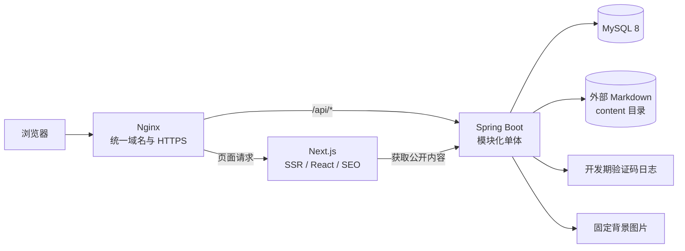
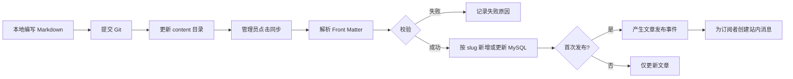

# 博客设计初稿

> 项目名称：Zpero の 小站  
> 文档版本：v1.0  
> 文档日期：2026-10-26  
> 项目目录：`D:\ZperoSite`

## 1. 项目定位

“Zpero の 小站”是一个以技术面试官为首要受众、同时服务于个人长期技术沉淀的博客网站。

网站希望让访问者在进入首页后的 10 秒内形成以下印象：

- 这是一个技术博客；
- 博主专注 Java 后端技术；
- 博主具备良好的审美和产品意识；
- 博主能够持续记录开发过程、技术难点和解决方案；
- 博主掌握 Spring Cloud、分布式事务、Redis 性能优化和 AI 应用开发等能力。

首页品牌表达：

```text
Alice の 小站

Javaer，理想不熄，技术不熄

专注 Spring Cloud 微服务、分布式事务、
Redis 性能优化与 AI 应用开发
```

内容重点：

- 日常代码和开发日志；
- 技术难点与解决方案；
- 项目开发过程和复盘；
- 技术选型与架构思考；
- 少量个人思考；
- 后续可将文章同步到知乎等内容平台。

前端风格参考 [XinghuisamaBlogs](https://github.com/heiehiehi/XinghuisamaBlogs)，只参考毛玻璃风格、布局和排版逻辑，不复制原作者的品牌、文章、头像、壁纸和个性化功能。二次开发与发布时遵守其 CC BY-NC 4.0 许可要求。

## 2. 设计原则

### 2.1 第一版优先上线

第一版不追求“大而全”，只完成一个可以真实使用并持续迭代的博客闭环：

```text
用户注册登录
→ 浏览文章
→ 点赞、收藏、评论
→ 订阅博客
→ 接收新文章站内通知

管理员维护 Markdown
→ 手动同步
→ 发布文章
→ 查看统计
→ 管理评论
```

### 2.2 不为展示技术而堆砌组件

第一版暂不使用：

- Spring Cloud；
- Redis；
- RocketMQ；
- Elasticsearch；
- 对象存储；
- Kubernetes；
- GitHub/QQ OAuth；
- AI 功能；
- 自动化部署。

这些能力应保留清晰的扩展位置，等真实需求出现后再加入。

### 2.3 模块化单体优先

后端采用一个 Spring Boot 应用，并按照业务模块组织代码。

优势：

- 部署和联调简单；
- 可以使用本地事务；
- 保持清晰的业务边界；
- 未来可以逐步拆分模块；
- 避免过早引入分布式事务和服务治理。

## 3. 技术选型

| 层级 | 技术 | 选择原因 |
| --- | --- | --- |
| 前端框架 | Next.js 16 | 基于 React，支持 SSR、SEO、Metadata 和文件路由，适合博客 |
| 前端语言 | TypeScript | 提高组件、接口和重构的可靠性 |
| UI 基础 | React | Next.js 的底层视图库 |
| 样式 | Tailwind CSS + CSS Variables | 快速实现响应式、毛玻璃和统一设计变量 |
| Markdown | react-markdown + GFM + 代码高亮 | 支持技术文章并控制危险 HTML |
| 后端 | Java 21 + Spring Boot 3.x | 符合个人技术方向，生态成熟 |
| 安全 | Spring Security | 登录、Session、权限与 CSRF 保护 |
| Session | Spring Session JDBC | 不依赖 Redis，重启可恢复，也为以后多实例留空间 |
| 数据访问 | MyBatis-Plus + 自定义 SQL | 常规 CRUD 简单，复杂统计和去重逻辑可控 |
| 数据库 | MySQL 8 | 存储用户、文章、互动、通知和统计数据 |
| 数据迁移 | Flyway | 数据库结构可版本化 |
| 参数校验 | Jakarta Validation | 统一校验邮箱、密码和评论内容 |
| 接口文档 | Springdoc OpenAPI | 方便前后端联调 |
| 本地环境 | Docker Compose | 第一阶段只需要启动 MySQL |
| 反向代理 | Nginx | 上线后统一 Next.js 与 Spring Boot 域名 |

Next.js 并不是 React 的替代品，而是为 React 补齐了路由、服务端渲染、静态生成、SEO 和工程能力。

## 4. 为什么第一版不使用 Redis

博客上线初期访问量有限，MySQL 足以承担：

- 文章查询；
- 邮箱验证码；
- 登录 Session；
- 评论、点赞和收藏；
- 浏览量去重；
- 站内通知。

此时引入 Redis 会额外增加部署、监控、数据一致性和故障恢复成本，却不会带来明显收益。

第一版对应方案：

| 功能 | 第一版实现 |
| --- | --- |
| 邮箱验证码 | MySQL 保存验证码摘要、有效期和验证状态 |
| 验证码频率控制 | 查询最近发送时间 |
| 登录 Session | Spring Session JDBC |
| 浏览去重 | 数据库唯一索引 |
| 点赞与收藏去重 | 数据库唯一索引 |
| 热门文章 | MySQL 按浏览量和点赞量排序 |

出现以下情况后再引入 Redis：

- 验证码和登录接口出现明显压力；
- Spring Boot 扩展为多个实例；
- 文章详情形成热点；
- 浏览量高频更新影响数据库；
- 需要实时热门排行榜。

建议引入顺序：验证码与限流 → Session → 文章缓存 → 浏览量聚合 → 排行榜。

## 5. 总体架构



开发环境：

```text
localhost:3000     Next.js
localhost:8080     Spring Boot
localhost:3306     MySQL
```

生产环境：

```text
https://example.com/        → Next.js
https://example.com/api/    → Spring Boot
```

同域部署可以简化 Cookie、Session、CSRF 和跨域问题。

## 6. 工程结构

```text
D:\ZperoSite
├── alice-blog-web/
├── alice-blog-server/
├── content/
│   ├── posts/
│   ├── projects/
│   └── images/
├── deploy/
│   ├── docker-compose.yml
│   └── nginx/
├── docs/
└── README.md
```

后端采用按业务分包：

```text
com.alice.blog
├── auth
│   ├── api
│   ├── application
│   ├── domain
│   └── infrastructure
├── article
├── interaction
├── notification
├── admin
├── profile
└── common
```

模块约束：

- Controller 只调用本模块应用服务；
- 模块之间不能直接调用对方 Mapper；
- 跨模块使用应用服务或领域事件；
- `common` 只存放真正通用的能力；
- 不提前创建空的 Redis、MQ 和 AI 服务。

## 7. 第一版功能

### 7.1 公开功能

- 首页；
- 文章列表；
- 分类和标签筛选；
- 文章详情；
- 关于我；
- 项目页骨架；
- 邮箱注册；
- 邮箱密码登录；
- 文章浏览量；
- 响应式移动端；
- SEO Metadata；
- Sitemap 和 robots.txt。

### 7.2 登录用户功能

- 点赞和取消点赞；
- 收藏和取消收藏；
- 查看收藏列表；
- 发表评论；
- 二级回复；
- 删除自己的评论；
- 订阅或取消订阅博客；
- 查看站内通知；
- 标记通知已读。

### 7.3 管理员功能

第一版严格限定为：

1. 查看访问统计；
2. 手动同步 Markdown；
3. 查看、隐藏和删除评论。

### 7.4 暂不实现

- 忘记密码；
- 第三方登录；
- 邮件订阅；
- 用户封禁；
- 私信；
- 无限层级评论；
- 全文搜索引擎；
- 项目管理后台；
- 背景图后台上传；
- AI 助手。

公开上线后应尽快补充忘记密码功能。

## 8. 核心业务设计

### 8.1 邮箱注册

```text
输入邮箱
→ 请求验证码
→ 后端生成验证码
→ 保存验证码摘要与有效期
→ 开发环境写入日志
→ 用户提交验证码和密码
→ 验证成功
→ BCrypt 加密密码
→ 创建用户
→ 建立 Session
```

安全规则：

- 验证码有效期 5 分钟；
- 60 秒内不能重复发送；
- 同一验证码最多尝试 5 次；
- 数据库不保存验证码明文；
- 密码使用 BCrypt；
- Cookie 使用 `HttpOnly` 和 `SameSite=Lax`；
- 生产环境启用 `Secure`。

开发期写入日志的验证码不能用于公网注册。正式开放注册前必须接入 SMTP 邮件服务，否则应关闭注册入口。

### 8.2 Markdown 同步

Markdown 是内容源，MySQL 是线上查询投影。



Front Matter 示例：

```yaml
---
title: Redis 热点 Key 优化实战
slug: redis-hot-key-optimization
summary: 一次热点 Key 的定位和优化过程
category: Redis
tags: [Redis, 性能优化]
publishedAt: 2026-10-26
status: published
cover: /images/posts/redis-hot-key.webp
---
```

同步规则：

- `slug` 是文章稳定身份；
- 使用内容哈希判断文件是否变化；
- 单篇失败不影响其他文章；
- 文件消失不会自动删除数据库文章；
- 只有首次进入 `published` 状态才发送通知；
- 同步操作写入审计日志；
- 数据库保存原始 Markdown；
- 前端渲染时清理危险 HTML。

### 8.3 点赞与收藏

- 必须登录；
- 每名用户对同一篇文章只能点赞一次；
- 可以取消点赞；
- 收藏规则相同；
- 使用数据库唯一索引防止重复数据。

### 8.4 浏览量

登录用户：

```text
viewer_key = U:{userId}
```

未登录设备：

```text
viewer_key = D:{匿名UUID}
```

匿名 UUID 由后端生成并保存到长期 Cookie，不使用浏览器指纹。

数据库唯一约束：

```text
(article_id, viewer_key)
```

同一身份对同一篇文章只增加一次。清除 Cookie、换浏览器或者从游客变为登录用户可能重新计数，因此浏览量是合理近似值，不宣称绝对唯一访客。

### 8.5 评论

评论只允许两级：

```text
顶级评论
├── 回复 @Zpero
├── 回复 @Bob
└── 回复 @Carol
```

数据库保存：

- 顶级评论 ID；
- 被回复评论 ID；
- 被回复用户 ID；
- 评论内容；
- 状态和删除时间。

无论第二级评论回复谁，都挂在对应顶级评论下，防止形成无限嵌套。

删除规则：

- 用户可以软删除自己的评论；
- 管理员可以隐藏或删除评论；
- 父评论删除后保留“该评论已删除”占位；
- 评论内容必须转义，禁止脚本注入。

### 8.6 站内订阅

首版只支持订阅整个博客：

```text
用户订阅
→ 管理员发布新文章
→ 触发 ArticlePublishedEvent
→ 为订阅用户创建站内通知
→ 用户登录后查看未读消息
```

第一版可以同步创建通知。订阅用户数量明显增加后，再改成本地消息表或 MQ 异步生成。

## 9. 核心数据模型

| 表 | 用途 |
| --- | --- |
| `user` | 用户、邮箱、密码摘要、角色和状态 |
| `email_verification` | 验证码摘要、过期时间、尝试次数 |
| `spring_session` | 登录 Session |
| `article` | 文章元数据、Markdown 正文、状态和内容哈希 |
| `category` | 文章分类 |
| `tag` | 标签 |
| `article_tag` | 文章标签关联 |
| `comment` | 评论、二级回复和软删除 |
| `article_like` | 用户点赞关系 |
| `article_favorite` | 用户收藏关系 |
| `article_view` | 用户或设备的唯一浏览记录 |
| `subscription` | 博客订阅关系 |
| `notification` | 用户站内通知和已读状态 |
| `markdown_sync_log` | Markdown 同步批次与结果 |
| `daily_stat` | 每日注册、浏览和互动统计 |
| `site_profile` | 博主公开资料 |

项目页首版只有展示骨架，不提前创建复杂项目表。未来项目内容明确后，新增独立 `project` 模块和 `content/projects` 目录。

## 10. 主要接口

统一前缀：

```text
/api/v1
```

认证：

```text
POST /auth/email-code
POST /auth/register
POST /auth/login
POST /auth/logout
GET  /auth/me
```

文章：

```text
GET  /articles
GET  /articles/{slug}
GET  /categories
GET  /tags
POST /articles/{id}/view
```

互动：

```text
PUT    /articles/{id}/like
DELETE /articles/{id}/like
PUT    /articles/{id}/favorite
DELETE /articles/{id}/favorite
GET    /favorites
POST   /articles/{id}/comments
POST   /comments/{id}/replies
DELETE /comments/{id}
```

订阅与通知：

```text
PUT    /subscriptions/blog
DELETE /subscriptions/blog
GET    /notifications
PATCH  /notifications/{id}/read
```

管理端：

```text
GET    /admin/statistics
POST   /admin/markdown/sync
GET    /admin/comments
PATCH  /admin/comments/{id}/hide
DELETE /admin/comments/{id}
```

## 11. 页面结构

```text
/
├── /articles
│   └── /articles/[slug]
├── /about
├── /projects
├── /favorites
├── /notifications
├── /login
├── /register
└── /admin
    ├── /dashboard
    ├── /sync
    └── /comments
```

项目页尚无真实内容时，不应在首页重点展示。路由可以保留，但导航入口应暂时隐藏或弱化，避免面试官进入空页面。

## 12. 首页布局

桌面端采用 12 栏网格，最大内容宽度约 1240px：

```text
┌────────────────────────────────────────────────────┐
│ Logo  首页 文章 关于 [项目]         搜索 登录/头像 │
├────────────────────────────────────────────────────┤
│                                                    │
│ Zpero の 小站                          虚拟头像     │
│ Javaer，理想不熄，技术不熄                         │
│ Spring Cloud · Redis · 分布式事务 · AI             │
│ [阅读文章] [关于我]                    状态/链接    │
│                                                    │
├────────────────────────────────────────────────────┤
│ 精选文章                                           │
│ ┌──────────────────┐ ┌───────────┐ ┌───────────┐  │
│ │ 主要精选文章     │ │ 精选文章  │ │ 精选文章  │  │
│ └──────────────────┘ └───────────┘ └───────────┘  │
├────────────────────────────────┬───────────────────┤
│ 最新文章（8栏）                │ 侧栏（4栏）       │
│ ┌────────────────────────────┐ │ 个人简介          │
│ │ 文章卡片                   │ │ 技术标签          │
│ └────────────────────────────┘ │ 分类              │
│ ┌────────────────────────────┐ │ 文章/访问统计      │
│ │ 文章卡片                   │ │ GitHub/邮箱/城市   │
│ └────────────────────────────┘ │                   │
└────────────────────────────────┴───────────────────┘
```

布局理由：

- 首屏优先介绍博主和技术方向；
- 精选文章比最新文章优先，便于控制面试官首先看到的内容；
- 侧栏只放辅助信息，不抢正文注意力；
- 没有真实项目时不展示空项目卡片；
- 首页避免堆积收藏、通知等产品功能。

## 13. 文章页面排版

```text
┌────────────────────────────────────────────────────┐
│ 返回文章   分类 / 标签                              │
├────────────────────────────────┬───────────────────┤
│ 文章标题                       │ 目录              │
│ 摘要、日期、阅读量             │ · 背景            │
│                                │ · 方案            │
│ 正文                           │ · 实现            │
│ 代码块                         │ · 总结            │
│ 图片                           │                   │
│                                │ 作者卡片          │
│ 点赞 · 收藏 · 订阅             │                   │
│ 评论区                         │                   │
└────────────────────────────────┴───────────────────┘
```

排版要求：

- 正文宽度控制在 720～780px；
- 中文正文行高约 1.8；
- 每行不宜过长；
- 代码块允许横向滚动；
- 目录在桌面端吸顶；
- 手机端目录折叠；
- 正文卡片比首页卡片更不透明；
- 文章页背景进一步压暗；
- 评论放在文章结束后。

## 14. 移动端布局

宽度低于约 768px 时：

- 导航变成菜单抽屉；
- 首页改为单栏；
- 虚拟头像缩小；
- 侧栏内容移动到文章列表之后；
- 精选文章纵向排列；
- 文章目录折叠；
- 降低背景轮播动画频率；
- 关闭高开销视差效果；
- 点击区域不小于 44px；
- 正文左右边距保持 16～20px。

不要把桌面多栏布局强行缩小到手机屏幕。

## 15. 视觉规范

### 15.1 背景

- 使用博主提供的固定图片；
- 首版不提供后台上传；
- 使用 3～5 张图片缓慢淡入淡出；
- 每张停留约 12～20 秒；
- 图片预先转换为 WebP/AVIF；
- 页面始终覆盖深色渐变遮罩；
- 尊重 `prefers-reduced-motion`。

### 15.2 毛玻璃卡片

建议范围：

```text
半透明深色背景
backdrop-filter: blur(16px～24px)
1px 低对比度高光边框
轻微阴影
圆角 16px～20px
```

不能给所有元素套卡片。标题、正文段落、标签组和按钮不应继续嵌套毛玻璃，否则页面会显得碎片化。

### 15.3 色彩

- 主背景使用深蓝黑或紫黑；
- 主文字使用高对比浅色；
- 次要文字使用中性灰蓝；
- 强调色控制为一种主色；
- 危险操作单独使用红色；
- 技术标签不使用随机的多彩配色。

### 15.4 动效

首版只保留：

- 背景淡入淡出；
- 卡片轻微悬浮；
- 页面内容短距离进入；
- 按钮和链接状态过渡。

首版不做粒子、3D、鼠标尾迹和大面积视差。

## 16. 管理后台布局

```text
┌──────────────┬─────────────────────────────────────┐
│ Zpero Admin  │ 页面标题                            │
│              ├─────────────────────────────────────┤
│ 数据概览     │ 统计卡片                            │
│ 内容同步     │                                     │
│ 评论管理     │ 表格 / 筛选 / 分页                  │
│              │                                     │
│ 返回网站     │                                     │
└──────────────┴─────────────────────────────────────┘
```

后台以效率和可读性为主，只保留轻量毛玻璃语言，不使用轮播背景干扰表格操作。

## 17. 安全设计

- 使用 BCrypt 保存密码；
- Session Cookie 使用 `HttpOnly`；
- 生产环境启用 HTTPS 和 `Secure`；
- 开启 CSRF 防护；
- 邮箱验证码限时、限频和限次数；
- 注册、登录和评论接口限流；
- 所有请求参数进行服务端校验；
- Markdown 禁止危险 HTML；
- 评论内容转义；
- Markdown 同步只读取固定根目录；
- 防止 `../` 路径穿越；
- 管理接口统一校验管理员角色；
- 数据库不使用 root 账号；
- 密钥只通过环境变量传入；
- `.env` 不提交到 Git。

第一版单实例可以使用本地或数据库限流；引入多实例后再迁移到 Redis 限流。

## 18. 扩展路线

| 需求出现时 | 扩展方案 |
| --- | --- |
| 验证码、登录压力增加 | Redis 保存验证码和 Session |
| 热门文章读取增加 | Spring Cache + Redis |
| 浏览量写入频繁 | Redis 聚合后批量写入 MySQL |
| 订阅用户数量增加 | 本地消息表 + MQ |
| 需要正文搜索 | 先 MySQL Fulltext，再接 Elasticsearch/OpenSearch |
| 背景和文章图片在线管理 | MinIO 或云对象存储 |
| 需要第三方登录 | Spring Security OAuth2 接入 GitHub/QQ |
| 需要 AI 问答 | 独立 AI 应用模块 + RAG |
| 需要多实例部署 | Redis Session、负载均衡和集中日志 |
| 某业务域需要独立扩容 | 从模块化单体中拆分服务 |

不提前为空想功能建立微服务。真正的扩展空间来自稳定的业务边界，而不是大量空接口。

## 19. 架构合理性复核

### 19.1 合理之处

- Spring Boot 模块化单体符合当前规模；
- MySQL 足以承载第一版业务；
- Next.js 解决 SEO 和首屏内容问题；
- Markdown 和 Git 适合长期技术写作；
- Session 比 JWT 更适合单一站点；
- 按业务模块组织代码，未来可以拆分；
- 外部内容目录避免 Markdown 被打包到 JAR；
- 文章发布事件为未来 MQ 留出切换位置。

### 19.2 主要风险

1. **Next.js 和 Spring Boot 是两个运行时。** 这比纯静态博客复杂，但注册、评论、通知以及展示 Java 能力确实需要后端，因此可以接受。
2. **Markdown 与 MySQL 形成两份文章内容。** 必须规定 Markdown 是内容源，MySQL 是线上投影，禁止直接修改数据库正文。
3. **日志验证码不能用于公开注册。** 上线前必须配置 SMTP，或暂时关闭公开注册。
4. **浏览量直接写 MySQL。** 第一版足够；出现写压力时再加入 Redis，不影响现有接口。
5. **背景轮播可能影响性能和阅读。** 通过图片压缩、深色遮罩、减少移动端动画和控制模糊区域解决。

结论：架构复杂度受控，并且在认证、缓存、通知、存储、搜索、AI 和部署方面保留了自然演进路径，不需要为未来可能发生的需求提前承担微服务成本。

## 20. 布局合理性复核

- 首屏突出 Zpero、个人主张和技术方向；
- 精选技术文章紧随首屏；
- 项目没有内容时不占据核心位置；
- 正文阅读宽度受到控制；
- 毛玻璃用于营造氛围，不破坏信息层级；
- 桌面端利用侧栏，移动端回归单栏；
- 管理后台不追求展示效果；
- 动效不成为页面主体。

网站可以参考 XinghuisamaBlogs，但不能为了相似而照搬其全部功能和视觉密度。首页必须让面试官快速看懂博主是谁、擅长什么、写过什么，而不是先研究页面如何操作。

## 21. 第一版验收标准

- `D:\ZperoSite` 中具有独立前端、后端和内容目录；
- Next.js 与 Spring Boot 可以本地启动；
- MySQL 可以通过 Docker Compose 启动；
- 首页、文章列表、文章详情和关于页可用；
- 桌面端和移动端布局正常；
- 邮箱验证码注册和登录可用；
- Markdown 可以由管理员手动同步；
- 点赞、收藏和浏览量去重可用；
- 二级评论可用；
- 博客订阅和站内通知可用；
- 管理员可以查看统计并管理评论；
- 刷新页面和服务重启后数据不丢失；
- 具备数据库迁移、环境变量示例和启动说明；
- 不包含正式上线使用的真实密钥。

## 22. 实施顺序

1. 创建工程目录与前后端骨架；
2. 完成首页、文章列表、文章详情和关于页视觉原型；
3. 建立 MySQL、Flyway 和后端模块；
4. 完成邮箱注册登录；
5. 完成 Markdown 同步和文章接口；
6. 完成点赞、收藏和浏览量；
7. 完成二级评论；
8. 完成站内订阅和通知；
9. 完成管理统计、同步和评论管理；
10. 完成响应式、测试、文档和本地验收；
11. 再购买云服务器和域名并完成上线。

本方案作为“​​Zpero の 小站”第一版的设计基线。后续修改应记录变更原因，避免在开发过程中无边界地增加功能。
